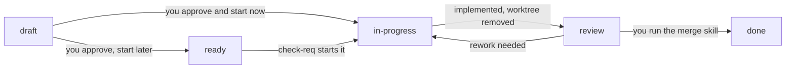

<h1 align="center">ss-workflow</h1>

<p align="center">
  A request-driven development workflow on top of gitflow, as a Claude Code plugin.
</p>

<p align="center">
  
  <a href="LICENSE"></a>
  <a href="https://code.claude.com/docs"></a>
  
</p>

<p align="center">
  English | <a href="README-zh-TW.md">繁體中文</a>
</p>

A Claude Code plugin that gives your projects a request-driven development workflow on
top of gitflow, without changing their repositories' layout. A workspace repository
wraps them: it holds the requests and the workflow files, and each project is a git
submodule in it. Every change starts as a request file whose spec you approve. An
agent implements it in its own git worktree, you verify and review it in the root
checkout, and skills merge and release it by the same rules every time.

- Your project keeps its own layout. It joins a workspace as a submodule, from a
  remote URL or a local path, and a workspace can hold several projects.
- The project's history only gets implementation commits, named and written like any
  other branch and commit of that project. Request ids, spec discussions, request
  status, and review results stay in the workspace, so every developer can keep a
  workspace of their own for the same projects.
- Every project has its own version: a project that did not change is not released.
- Every change is a request file, and nothing is implemented before you approve its
  spec, including the software architecture.
- Agents implement in separate git worktrees, so several sessions can work on several
  requests in parallel.
- Verify, an optional code review, and your manual review happen in the root checkout,
  on the request branches.
- Merges and releases follow fixed gitflow rules: `--no-ff` merges, tags, and a
  recommended version number.
- It does not depend on a project type: a Visual Studio solution, a Keil project, an
  ESP32 firmware, a repository of analysis reports, or anything else works the same
  way.
- It works without a remote, with any git remote, or with merge requests on GitHub or
  GitLab. A setting decides whether the agent pushes by itself, asks first, or never
  pushes.
- Every request keeps the questions that were asked and what you answered, and every
  result says what ran, what failed, and what did not run.

> [!WARNING]
> **Status: 0.8.0, early.** The six skills are written and the plugin manifest
> validates, but the workflow has not yet been run end to end on a real project.

<details>
<summary>Table of contents</summary>

- [Getting started](#getting-started)
  - [Requirements](#requirements)
  - [Installation](#installation)
  - [Quick start](#quick-start)
- [Skills](#skills)
- [How a request moves](#how-a-request-moves)
- [Branching model](#branching-model)
- [Remote and pushing](#remote-and-pushing)
- [Workspace layout](#workspace-layout)
- [Project types](#project-types)
- [Updating](#updating)
- [Developing this plugin](#developing-this-plugin)
- [License](#license)

</details>

## Getting started

### Requirements

- [Claude Code](https://code.claude.com/docs)
- git
- Optional: the `gh` or `glab` CLI, for merge requests on GitHub or GitLab
- The tools of your project's own toolchain. The plugin itself needs none of them.

### Installation

Add this repository as a plugin marketplace, then install the plugin. Run these inside
a Claude Code session:

```text
/plugin marketplace add <owner>/ss-workflow
/plugin install ss-workflow@ss-workflow
```

Replace `<owner>/ss-workflow` with the GitHub repository, or use the full git URL for
another host.

> [!TIP]
> To let everyone who works in a workspace get the plugin, `/ss-workflow:init` can
> register the marketplace in the workspace's `.claude/settings.json`.

### Quick start

In a new, empty folder, for example `SSDisp-workspace`:

```text
/ss-workflow:init https://github.com/me/SSDisp.git   set up the workspace with a project (a URL or a local path)
/ss-workflow:init --add ../SSLib                      add another project later
/ss-workflow:new-req add a dark theme                 create a request, agree on its spec, and start it
/ss-workflow:check-req                                see what is pending, start a later request, or continue one
/ss-workflow:review                                   verify it and review it in the root checkout
/ss-workflow:merge                                    accept it: merge the projects, then close it
/ss-workflow:release SSDisp                           release a new version of one project
```

## Skills

| Skill | When to use it | Where it runs | What it does |
|-------|----------------|---------------|--------------|
| `/ss-workflow:init` | Once per workspace, to add a project, and again after a plugin update | Root checkout | Creates the workspace: the git branches, `AGENTS.md` / `CLAUDE.md`, and the README files, and adds projects as submodules from a URL or a local path. Converts a repository of version 0.5.0 or older, or upgrades a workspace made by an older version. |
| `/ss-workflow:new-req` | You have a new feature, fix, or other change | Root checkout, on the request branch | Creates the request branch and the request file, settles which projects it changes, and discusses the spec with you. When you approve, it starts the implementation right away, or keeps the request `ready` for later. |
| `/ss-workflow:check-req` | You want to see what is pending, or start or continue an implementation | Root checkout for the overview and the start; worktrees for the implementation | Lists all requests, repairs inconsistent ones, and recommends what to work on next. Starts a `ready` request (worktrees and project branches) or resumes an `in-progress` one in its worktree, and implements it. Then it marks the request for review and removes the worktrees. |
| `/ss-workflow:review` | An implemented request waits for you | Root checkout, on the request branches | Verify: runs each project's build, tests, and verification scripts. Code review (optional): reads the request's changes for bugs. Review: guides you through the manual check. Applies small fixes, or sends the request back for rework. |
| `/ss-workflow:merge` | You accept a reviewed request, or a release or hotfix is ready | Root checkout | Merges the project branches, then closes the request and merges the workspace branch. Creates the tags for releases and hotfixes, and deletes the branches. |
| `/ss-workflow:release` | You want to release a new version of a project | Root checkout | Recommends the project's version, creates its release branch, checks for its unfinished work, sets the version number, and hands over to the release merge. |

> [!NOTE]
> The root checkout is the workspace's primary working tree. Tests, scripts, and
> executables only run there. In a worktree, the agent writes code and tries to compile
> it, because running things in a worktree is more restricted.

Each skill belongs to the `ss-workflow` plugin, so its name starts with
`/ss-workflow:`. Always type that prefix. The names after it are short and common,
and some of them, such as `/init`, are also Claude Code's own commands.

## How a request moves



| Status | Meaning | Where the work happens | Set by |
|--------|---------|------------------------|--------|
| `draft` | The spec is under discussion | Root checkout, on the request branch | `/ss-workflow:new-req` |
| `ready` | You approved the spec and chose to start it later | (nothing) | `/ss-workflow:new-req` |
| `in-progress` | Started; being implemented | A worktree of the workspace, with a worktree of each project inside it | `/ss-workflow:check-req` |
| `review` | Implemented; the worktrees are removed and the branches are kept; waiting for or under Verify and Review | Root checkout, on the request branches | `/ss-workflow:check-req`, then `/ss-workflow:review` |
| `done` | Closed; the file is in `reqs/done/` | Root checkout | `/ss-workflow:merge` |

A request is one Markdown file in the workspace,
`reqs/REQ-0012-20260907-gui-button.md`. Its YAML frontmatter is the only place that
holds its state, and names the projects that it changes (`projects: [SSLib, SSDisp]`).
Your original text is kept unchanged in its `## Original` section.

| Section | Holds |
|---------|-------|
| `## Spec` | The agreed specification: goal, scope, architecture, acceptance criteria, how to verify, out of scope |
| `## Original` | Your request as you gave it, never edited |
| `## Q&A` | Every question that changed the request, your answer in your own words, and the decision, in the order asked. An open question has `A: (pending)`. |
| `## Notes` | Assumptions, the implementation summary, behavior changes, and the Verify, code review, and Review results, each with a date |

- One workspace branch, `feat/REQ-0012-gui-button`, carries the request from the
  first draft through the implementation and the review. `develop` gets it only with
  the merge.
- The discussion is committed when the draft is created, when you pause it, and when
  you approve it, not after every round.
- You can approve a request only when no question in `## Q&A` is pending. Answered
  entries are never rewritten: a changed decision is a new entry.
- Starting a request needs no lock: every developer usually has a workspace of their
  own. Each project of the request gets a branch named after the change, without the
  request id (`feat/gui-button`). The request file records that name in
  `project-branch`.
- A request can also change the workspace's own files: a spec in `docs/<project>/`,
  the knowledge base, or a project's rules in `projects/AGENTS.md`. You read those changes
  in the Review. A request that changes nothing else has `projects: []`.
- Code is committed in the projects, as plain commits that describe the change. No
  project commit, merge commit, merge request, or changelog entry names the request
  or the workspace. The workspace records which project commits a request produced,
  as gitlinks.
- Small problems found during Verify or Review are fixed in the root checkout. A
  request that needs larger rework goes back to `in-progress` and into a worktree.
- You can change code by hand during a review. `/ss-workflow:review` lists every
  uncommitted change, new files included, and asks you what each one is: part of the
  request (committed), a generated file (added to `.gitignore`), or unwanted
  (discarded). A Verify result only counts when it ran on a clean working tree.
- A code review is optional. `/ss-workflow:review` offers it after Verify passed, and
  runs Claude Code's `/code-review` on the changes of the request only, in each
  project (`origin/develop...<request branch>`). You can also ask for it later in the same
  review. Its result is recorded in the request's `## Notes`.
- Results are reported as they are. Every check is recorded as `passed`, `failed`,
  `did not run`, or `not configured`, and the implementation summary lists what is not
  done. A check that did not run is never recorded as passed.
- A change to a file that tells an agent how to behave (`AGENTS.md`, `CLAUDE.md`,
  `.claude/`, a skill, or a path in the `agent-files` setting) is reviewed as a change
  of behavior: the request records what an agent did before and what it does now, and
  you confirm each item in the Review. No build or test shows such a change.

## Branching model

Both the workspace and every project follow gitflow, each with its own `master` (or
`main`) and `develop`.

| Branch | Workspace | Project | Example |
|--------|-----------|---------|---------|
| Request | From and into `develop`, from the first draft on | Named after the change, from and into its `develop` | `feat/REQ-0012-gui-button`, `feat/gui-button` |
| Release | No branch: `develop` merges into `master`, tagged `SSDisp/v1.0.0-beta1` | From `develop`, into `master` and `develop`, tagged `v1.0.0-beta1` | `release/v1.0.0-beta1` |
| Hotfix | From and into `master`, and into `develop`, tagged `SSDisp/v1.0.1` | From and into `master`, and into `develop`, tagged `v1.0.1` | `hotfix/SSDisp-v1.0.1`, `hotfix/v1.0.1` |

- A project's `master` only receives its releases and hotfixes. Before its v1.0.0,
  its `develop` may also be merged into it directly.
- The workspace `master` is the set of the latest released projects: each release
  merges `develop` into it and points every project to its own `master`.
- A request is merged project by project, and the workspace last.
- Request and hotfix branches are implemented in git worktrees under
  `.claude/worktrees/`, with a worktree of each project inside, so several sessions
  can implement several requests in parallel. A worktree only lives during the
  implementation.
- Spec discussions, reviews, merges, and releases share the root checkout, so only one
  of them runs at a time.
- Every merge uses `--no-ff`. A branch can be merged locally, or through a merge
  request on GitHub or GitLab.

## Remote and pushing

The workflow does not need a remote. Without one, the requests live on local
branches, and every branch is merged locally. Every step that fetches, pulls, or pushes is skipped.

The workspace and each project decide this on their own: a project can override the
workspace's settings, for example when its repository requires merge requests while
the workspace lives on your machine only. With a remote, the `push-policy` setting in
the root `AGENTS.md` decides what the agent pushes:

| `push-policy` | The agent | Fits |
|---------------|-----------|------|
| `auto` (default) | Pushes its topic branches after every commit, and `develop` after a merge that you asked for | Several machines or sessions that share a remote: new requests and status changes are visible at once |
| `ask` | Commits locally, and asks before the first push of a skill run | You want to see what leaves the machine |
| `never` | Never pushes and never deletes a remote branch. Each skill lists what you have to push. | Strict rules about who publishes |

- For every value, the agent asks right before it pushes a `master` or a tag, never
  force-pushes, and never deletes a branch before its merge is confirmed.
- A project added from a local path without a remote never pushes: its remote would
  be your own working copy.
- `remote-platform` is a separate setting. It only says whether merge requests can be
  opened (`github`, `gitlab`). For any other remote it is `none`, and branches are
  merged locally and pushed.
- If the remote refuses a push to a protected branch, the skills do not work around
  it. They open a merge request, or stop and say what has to be merged on the remote.

## Workspace layout

```text
SSDisp-workspace/
├─ AGENTS.md, CLAUDE.md      workflow rules and settings for agents (CLAUDE.md imports AGENTS.md)
├─ README.md, README-zh-TW.md
├─ reqs/                     open requests; finished ones in reqs/done/
├─ docs/
│  ├─ overview.md            what the projects do together
│  ├─ SSLib/spec.md          the spec of each project, with its other docs
│  └─ SSDisp/spec.md
└─ projects/
   ├─ AGENTS.md              the toolchain and the rules of each project
   ├─ SSLib/                 a submodule: the SSLib repository, in its own layout
   └─ SSDisp/                a submodule: the SSDisp repository, in its own layout
      ├─ SSDisp.sln
      ├─ SSDisp/
      └─ SSDisp.Test/
```

Init writes nothing into the projects. Their tests, samples, and third-party files
stay where their toolchain puts them.

> [!IMPORTANT]
> Repositories set up by ss-workflow 0.5.0 or older kept the code and the requests in
> one repository. Running `/ss-workflow:init` there converts it: the old repository
> becomes the project repository, with its remote, history, and tags, and goes back to
> the layout of its toolchain. A new workspace next to it takes the requests, the
> drafts, and the docs. No request, release, or hotfix may be in progress.

## Project types

The plugin ships no templates or commands for any toolchain. During init you describe
the type of each project in your own words, and the agent proposes the values below
for you to confirm. They are stored in the workspace, and every skill reads them from
there.

| What | Where it is stored |
|------|--------------------|
| Branches, main project file, version source, and the setup, build, test, and verify commands of each project | The project's entry in `projects`, "Workflow settings" in the root `AGENTS.md` |
| Extra files that tell an agent how to behave, such as prompt files that the product ships (`agent-files`) | "Workflow settings" in the root `AGENTS.md` |
| Required tools, how to find tools that are not on `PATH`, known limits | "Toolchain" in the project's section of `projects/AGENTS.md` |
| How new files and projects are registered with the build, generated files, naming | "Project rules" in the project's section of `projects/AGENTS.md` |
| Build output and local files to ignore | The project's own `.gitignore` |

> [!NOTE]
> A command may stay empty, for example when a project can only be built inside an
> IDE. The skills then skip that step and report it as "not configured". They do not
> invent a command.

A project does not have to be code. For a repository of documents or analysis
reports, leave the build and test commands empty, or set `verify-command` to a
script that checks the reports (links, data, formatting). The Review is where you
read the result.

## Updating

The marketplace compares the `version` in `.claude-plugin/plugin.json` with the
installed version.

```text
/plugin marketplace update ss-workflow
```

> [!IMPORTANT]
> A plugin update does not change the files that init generated in your workspace.
> After an update, run `/ss-workflow:init` in the workspace again. It compares the
> `ss-workflow-version` recorded in the root `AGENTS.md` with the plugin version, and
> updates only the blocks marked `<!-- ss-workflow:managed -->`. Your own text outside
> those blocks stays as it is.

Some versions need more than new rule text, for example a new setting or a change to
the request file format. Each of them ships a migration file,
`skills/init/migrations/<version>.md`. The upgrade applies these files in version
order, from the version that your repository records up to the installed one. For each
file it first tells you how the workflow behaves differently, then proposes the
changes outside the managed blocks, and changes nothing there without your answer.

## Developing this plugin

```text
.claude-plugin/
├─ plugin.json               plugin manifest; "version" is the single version source
└─ marketplace.json          makes this repository its own marketplace
skills/
├─ init/                     SKILL.md, references/, templates/, migrations/
├─ new-req/                  SKILL.md
├─ check-req/                SKILL.md, references/
├─ review/                   SKILL.md
├─ merge/                    SKILL.md, references/
└─ release/                  SKILL.md, references/
tests/git-sequences.sh       checks the git steps that the skills prescribe
tests/migrations.sh          checks that a template change ships a migration file
ss-workflow-skill.md         the design spec (Traditional Chinese)
```

Validate the manifests, and load the plugin from the working copy for one session:

```bash
claude plugin validate .
```

```bash
claude --plugin-dir /path/to/ss-workflow
```

The skills rely on git behaving in specific ways: how a request branch carries a
request from draft to merge, how project worktrees sit inside a workspace worktree
and are removed, how a closed
request and its gitlinks reach `develop`, how a release sets the gitlinks of the
workspace `master`, how a hotfix is merged, and how an old repository is converted.
This script runs those command sequences in a temporary sandbox and checks the
results. It tests git, not
the agent. Run it again when you change the git steps of a skill:

```bash
bash tests/git-sequences.sh
```

The files under `skills/init/templates/` end up in other repositories, and a plugin
update does not reach them. A version that adds a setting, changes the request file
format, moves a generated file, renames a skill, or changes how the workflow behaves
needs a migration file. [skills/init/migrations/README.md](skills/init/migrations/README.md)
describes when one is needed and its format. This script fails when the templates
changed since the last release tag and no migration file for a newer version exists:

```bash
bash tests/migrations.sh
```

> [!IMPORTANT]
> When you publish a change, raise `version` in `.claude-plugin/plugin.json`, and the
> version badge and the status line at the top of both README files. Without a new
> version, installed copies do not update. Name the migration file after that version.

The design decisions behind the skills are recorded in
[ss-workflow-skill.md](ss-workflow-skill.md).

## License

MIT. See [LICENSE](LICENSE).
